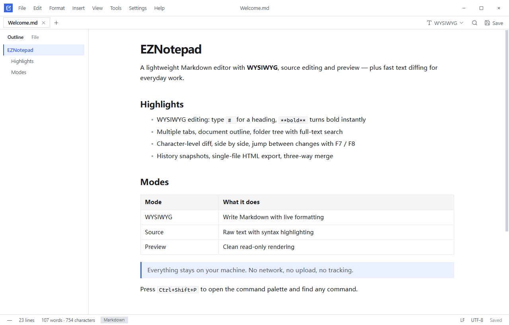
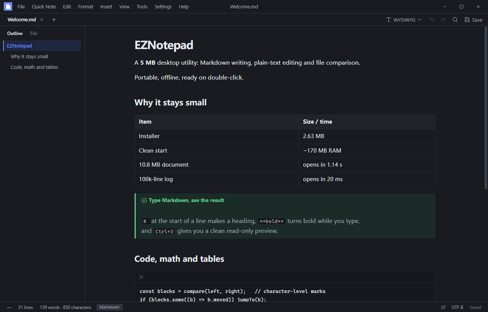
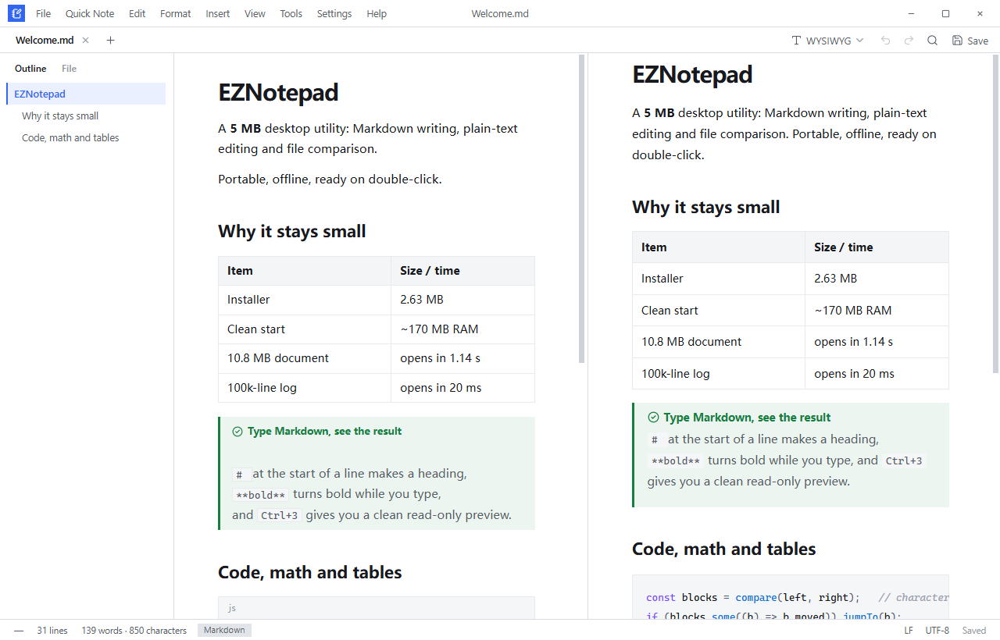
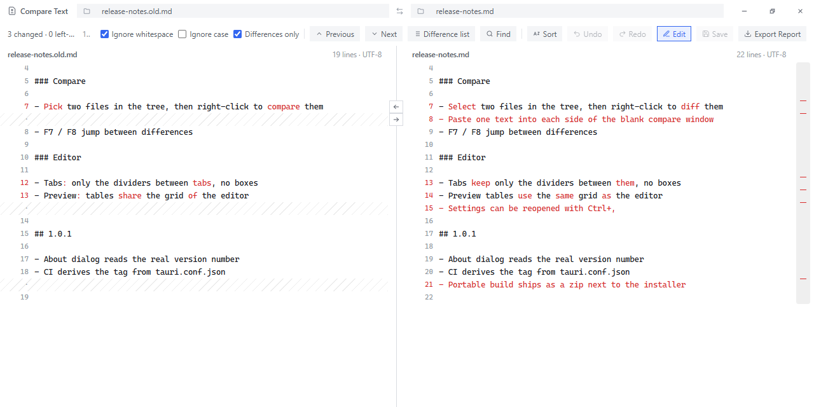

<div align="center">

# EZNotepad

> **5 MB** のデスクトップツール：Markdown 執筆 + テキスト編集 + ファイル比較。
> インストール不要、オフライン、ダブルクリックですぐ使える。
> UI は 9 言語。システム言語に追従し、**設定 → 言語** で手動切り替えもできる。

[English](README.md) | [简体中文](README.zh-CN.md) | [繁體中文](README.zh-TW.md) | **日本語** | [한국어](README.ko.md) | [Français](README.fr.md) | [Deutsch](README.de.md) | [Español](README.es.md) | [Português](README.pt.md)

[](https://github.com/EZLive00/EZNotepad/releases)
[](./LICENSE)

</div>

---

## ダウンロード

| ファイル | 向いている人 |
|---|---|
| `EZNotepad_<バージョン>_x64-setup.exe` | **インストーラー** — セットアップウィザードとファイル関連付け。`.md` / `.txt` をダブルクリックでここが開く |
| `EZNotepad_<バージョン>_x64-portable.zip` | **ポータブル** — 任意のフォルダーに解凍して `EZNotepad.exe` を実行（レジストリも関連付けも触らない） |

コード署名はしていないため、初回起動時に SmartScreen が一度止める：**詳細情報 → 実行** を選ぶ。
対応は今のところ Windows x64 のみ。ポータブル版は OS 標準の WebView2 を使う（Win10 / Win11 は同梱）。

## スクリーンショット

| ライト | ダーク |
|---|---|
|  |  |

| 左で書いて右でプレビュー | テキスト比較：行単位＋文字単位のマーク |
|---|---|
|  |  |

## 何を置き換えるか

| これまで | 理由 | ここでは |
|---|---|---|
| メモ帳 | 任意のテキスト、文字コード切替、ログ閲覧 | 同じことができるうえ、行番号・ハイライト・アウトライン付き |
| Typora | Markdown を書きながら表示 | 3 モード、サイズは 20 分の 1 |
| BeyondCompare | 2 つのファイルの比較 | 並べて表示、文字単位のマーク、`F7` / `F8` で差分移動 |

## 3 つのモード

| モード | できること | ショートカット |
|---|---|---|
| **WYSIWYG** | 行頭に `# ` で見出し、`**太字**` は打った瞬間に反映 | `Ctrl+1` |
| **編集** | 生の Markdown / ソース。CodeMirror 6、行番号と折りたたみ | `Ctrl+2` |
| **プレビュー** | 読み物としての表示専用 | `Ctrl+3` |

`.md` は 3 モードすべて。`.json` は検証とエラー位置の表示。`.txt` `.log` `.csv` とコード
（`.js .ts .py .rs .go .html .css .sql .yml` …）は編集 / プレビューのみで、普通のテキストエディターとして使える。
新規ファイルは先に種類を選ぶ（Markdown / プレーンテキスト / JSON / CSV / コード）。

## 編集

| | |
|---|---|
| **ブロック** | 行頭の `# ` 見出し、`- ` / `1. ` / `- [ ] ` リスト（6 階層）、`> ` 引用、` ``` ` コード、`---` 区切り線 — マーカーは行頭にあるだけでよい |
| **インライン** | `**太字**`、`*斜体*`、`~~打ち消し~~`、`` `コード` ``、`[文字](リンク)` を打つそばから描画 |
| **元に戻す / やり直す** | ツールバー左端の 2 つの矢印（端まで来るとグレー）、`Ctrl+Z` / `Ctrl+Y`、`Ctrl+Shift+Z` もやり直し —— WYSIWYG とプレーンテキストはそれぞれ独自の履歴を持ちます |
| **表** | `Ctrl+Shift+T` で挿入。`Tab` でセル移動、`Enter` で次行の同列へ、右クリックで行・列の追加削除と揃え |
| **画像** | スクリーンショットを貼る、ファイルをドラッグ、または **挿入 → 画像**：文書の隣の `assets/` にコピーされる。右下をドラッグで幅変更、`` の手書きも可 |
| **数式** | `$a^2+b^2=c^2$` はインライン、`$$ … $$` はブロック。プレビューで KaTeX が組む（数式があるときだけ読み込む） |
| **コールアウト** | `> [!info]` / `warning` / `danger` / `success`。GitHub の別名も受け付ける |
| **ブロックハンドル** | 行頭に `+` と `⋮⋮` が浮く：ブロックを挿入、またはこのブロックを別の種類へ変換 |
| **貼り付け** | 複数行のテキストは Markdown として解析され、見出し・リスト・表になる（ひと塊にならない） |

ブロック種別の変更（`Ctrl+Shift+Q` 引用、`Ctrl+Shift+K` コード…）、**書式**メニュー、右クリックメニュー、
`Ctrl+Shift+P` のコマンドパレットは同じコマンド群を通る。使えない項目は自動でグレーになる。

### 検索と置換

1 つのオーバーレイに 2 つの状態：`Ctrl+F` はフォーカスだけ、`Ctrl+H` は置換行まで開く。
**WYSIWYG のまま検索できる** — ハイライトは描画層に描かれ、本文にタグを差し込まない。

`Aa` 大文字小文字を区別 · `.*` 正規表現 · 単語単位（両端が英字のときだけ語境界を足す。中国語に語境界はない）·
選択範囲内 · `↵` で検索語に改行を入れる。同じ書式の連続した文字ならその場で置換し、太字やリンクをまたぐときだけ編集モードへの切り替えを尋ねる。

## 比較

`Ctrl+D`（または `Ctrl+Shift+N`）で比較ウィンドウが開く。中身は空のまま — 入り方は任せる：

- **2 つのファイル** — サイドバーの「ファイル」で `Ctrl` / `Shift` で複数選択し、右クリック → **この2つのファイルを比較**（右クリックした方が左）
- **2 つのテキスト** — **2つのテキストを貼り付け** を押して両側に貼るだけ。ファイルがなくても比べられる
- **そのまま編集** — **編集** で両側が書き込み可能に。**保存** は実ファイルがある側にだけ書き戻す

行単位のマークがどの行が変わったかを、文字単位のマークがどの文字が変わったかを示す。`F7` / `F8` で差分を移動、**レポートを書き出す** で単体の HTML 差分を作る。
右端のルーラーは全体のどこかを表し、ホバーで行番号、クリックやドラッグで移動できる。**差分リスト** は各変更を並べ替え・絞り込みできる一覧にする（位置 / 種類 / 行数）。
**並べ替え** は両側の行を辞書順に並べ替えます（空行は末尾）。順序のノイズが本当の増減を隠さなくなります。`Ctrl+Z` で元に戻せます。
編集モードでは入力・改行・インデント・選択範囲の削除・並べ替えのすべてを `Ctrl+Z` / `Ctrl+Y` で元に戻す・やり直せます（フォーカスがツールバーにあっても効きます）。
ツールバーにも同じ 2 つのボタンがあり（履歴の端ではグレー表示）、ウィンドウを狭くするとこの行はアイコンに畳まれ、右側のボタンが切れることはありません。
片側の上限は 8MB / 5 万行で、超えた場合は理由を明示する。

**フォルダー比較** は「左のみ / 右のみ / 内容違い / 同一」を再帰的に一覧し、行をクリックすればそのファイルの比較へ。
**3 方向マージ** は「基準 + A + B」を自動統合して競合を並べる。結果は新しいタブで開くだけで、元ファイルは上書きしない。

## ファイルと検索

サイドバーは 2 ページ：**アウトライン**（スクロールに合わせて現在の章をハイライト）と **ファイル**。

- ディレクトリーツリーは必要に応じて展開。右クリックで作成・名前変更・削除 — 削除は**ごみ箱**へ、フォルダーは空のときだけ削除できる
- 検索は Rust 側で実行。バイナリーと 4 MB 超のファイルを飛ばし、最大 200 件をファイル単位・行番号付きで返す
- `.*` で正規表現、`Aa` で大文字小文字の区別
- **すべて置換** はファイルをまたいで実行。先に一度確認し、各ファイルの変更前にスナップショットを残す
- 開いている文書はリアルタイム監視（`ReadDirectoryChangesW`）：現在のタブは黙って再読み込み、背面のタブは黄色い点が付き、切り替えたときに尋ねる

## そのほか

| | |
|---|---|
| **一括整形** | `Ctrl+Shift+F` — JSON は検証して整形し直す（エラー時はファイルを触らず行・桁を報告）、Markdown は空行補完とリスト記号の統一、それ以外は行末空白の削除。`Ctrl+Z` 1 回で全部戻る |
| **変更履歴** | 保存のたびに直前の内容を残す（1 ファイル 60 件、合計 20 MB）。**表示** は読み取り専用で開き、**復元** はエディターに書き戻す — `Ctrl+S` を押すまでディスクは変わらない |
| **書き出し** | 単一ファイル HTML（スタイルはインライン、画像は data URI）。PDF は OS の印刷ダイアログ経由 |
| **ショートカット** | 設定 → ショートカット でどれでも変更可。カスタムが優先、**リセット** で 1 件だけ戻す、**既定に戻す** で全部消す |
| **集中モード** | `F9` でタブ・サイドバー・ステータスバー・メニューを畳む。タイトルバーは消さず 28% まで薄くする（消すとウィンドウをドラッグも閉じることもできなくなる） |
| **単一インスタンス** | 別のファイルをダブルクリックしても 2 つ目のプロセスは立たず、動いているウィンドウにパスを渡す |
| **文字コード** | ステータスバーの `UTF-8` や `LF` をクリックして文字コード（GBK / UTF-16 / BOM）や改行コードを変更 |

## ショートカット

| 動作 | キー |
|---|---|
| 新規 / 開く / 保存 / 名前を付けて保存 | `Ctrl+N` / `Ctrl+O` / `Ctrl+S` / `Ctrl+Shift+S` |
| タブを閉じる / 次のタブ | `Ctrl+W` / `Ctrl+Tab` |
| 検索 / 置換 / 行へ移動 | `Ctrl+F` / `Ctrl+H` / `Ctrl+G` |
| コマンドパレット / 設定 | `Ctrl+Shift+P` / `Ctrl+,` |
| 整形 / 比較 | `Ctrl+Shift+F` / `Ctrl+D` |
| 次の差分 / 前の差分 | `F8` / `F7` |
| 1 ペイン ⇄ 2 ペイン / アウトライン | `Ctrl+Shift+L` / `Ctrl+Shift+O` |
| 集中モード / 全画面 | `F9` / `F11` |
| 太字 / 斜体 / 打ち消し / インラインコード | `Ctrl+B` / `Ctrl+I` / `Ctrl+Shift+X` / `Ctrl+Shift+K` |
| リンク / 表 / 引用 | `Ctrl+K` / `Ctrl+Shift+T` / `Ctrl+Shift+Q` |
| 本文 / 見出し 1〜3 | `Ctrl+Alt+0` / `Ctrl+Alt+1~3` |
| 箇条書き / 番号付き / タスク | `Ctrl+Shift+8` / `Ctrl+Shift+7` / `Ctrl+Shift+9` |
| リストのインデント / 解除 | `Tab` / `Shift+Tab` |
| 拡大 / 縮小 / リセット | `Ctrl+=` / `Ctrl+-` / `Ctrl+0` |
| PDF 書き出し | `Ctrl+P` |

## 性能

ローカル実測（Windows 11、x64、release ビルド）：

| シナリオ | 指標 |
|---|---|
| 600 段落の文書で入力 | 1 キーあたり **9.1 ms** |
| 10.8 MB / 77,866 ブロックを開く | **1.14 s**、DOM にあるのは約 48 ブロック、固まらない |
| 同じ文書で入力 / スクロール / 元に戻す | p50 **0.3 ms** / 1 フレーム約 **17 ms** / 1 回 **37 ms** |
| CodeMirror 6 のプレーンテキスト | 5 万行 **49 ms**、10 万行 **20 ms** |
| メモリー / インストーラー | 起動直後およそ **170 MB** / **2.63 MB** |

巨大な Markdown はビューポート描画：見えているブロックだけが DOM に入り、残りは記録として持つ。
元に戻すスナップショットは記録の配列なので、1 文字打つたびに文書全体を複製しない。

## データ

ファイルの読み書きはすべてこのマシンの中だけ — **通信なし、アップロードなし、計測なし**。
未保存タブの下書きはローカルのアプリデータに置かれ、次回起動時に復元するか尋ねる。履歴スナップショットは
同じ場所の `history/` にあり、文書フォルダーとは完全に分かれている。

## 既知の制限

- PDF は OS の印刷ダイアログ経由なので、レイアウトは印刷出力に従う
- 3 方向マージは自動統合＋競合一覧で、4 ペインのビジュアルマージャーはない（複雑な競合はテキスト比較で 1 ブロックずつ）
- 数式はプレビューでのみ描画し、WYSIWYG ではソース表示。Mermaid は未対応
- ファイルをまたぐ置換は UTF-8 のみ。GBK などは黙って変換せずスキップする
- ファイルツリー自体は監視しない。外部で増減したら右クリックメニューの **更新**
- 各プラットフォームのインストーラーはその OS 上でビルドする必要がある（`docs/构建说明.md` 参照）。設計と移植の資料は `docs/` にあります

## ライセンス

[GNU Affero General Public License v3.0](LICENSE) — 使用・学習・改変・再配布は自由。派生物
（この上に構築したホステッドサービスを含む）も AGPL-3.0 で公開する必要がある。
